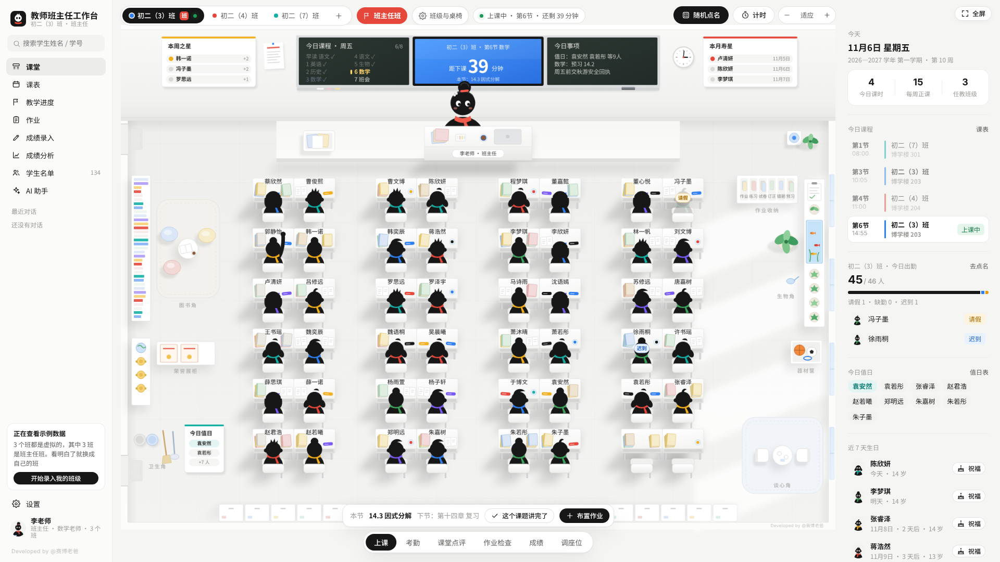

# 乐智托管 · 使用说明

> 个人工作台系列 · 当前版本 v2.1.0
> 一个 HTML 文件，双击就能在浏览器里打开。给独立教师、托管班老师管理班级、课表、学生和成绩用。
> 每次更新的内容见 [CHANGELOG.md](CHANGELOG.md)。

---

## 一、这个工具能做什么

乐智托管把老师每天要做的事放进同一个地方：

- **课堂**：一间教室，讲台上站着你，下面是全班同学。点名、考勤、课堂点评、成绩速录、调座位都在这一页完成。
- **课表**：每周固定课表，临时调课只改当天；可以导出到手机日历，课前提醒。
- **作息模板**：平时、周末、寒暑假可以各建一套作息，每个班绑定自己那一套，上课时间和倒计时自动按模板算。
- **教学进度**：按课题记录讲到哪了，各班进度一眼对比。
- **成绩**：单科或全科录入、排名、分数段、平行班对比、进步退步分析。
- **学生名单**：档案、标签、备注、成长记录、家长沟通记录，支持从 Excel 粘贴导入。
- **AI 助手**（可选）：接自己的大模型 API Key，写教案、出分层练习、做试卷分析、写评语；不配置也能复制提示词到网页版使用。

## 二、为什么用它

- **打开就能用**：不用注册、不用安装、不用联网，学校电脑装了还原卡也能用。
- **数据在自己电脑上**：所有数据只存在本机浏览器里，不上传、不统计、不联网（AI 功能除外，且由你自己配置）。
- **好看也好用**：每个班是一间教室，谁请假、今天上什么课、离下课还有几分钟，抬头就能看到。

## 三、开始使用

1. 双击 `index.html`，用 Chrome、Edge 等现代浏览器打开。
2. 欢迎页选形象、填称呼和学科；可以先点「先看看示例数据」熟悉界面。
3. 进入「设置 → 我教的班级」新建班级，粘贴学生名单。
4. 到「课表」排课，到「设置 → 作息时间」确认节次和时间。

> 建议把 `index.html` 放在一个固定文件夹里，并在浏览器里收藏，避免每次找文件。

## 四、功能怎么用

### 1. 班级与教室

- 教室顶部是班级栏，点一下切换班级；每个班有自己的学生、座位和桌椅摆法。
- 右上角「班级与桌椅」可以调整每组人数、排数、讲台两侧位置，也可以按学号或按小组自动排座。
- 点学生可以看悬浮卡：成绩、点评、考勤、备注；点座位可以调座或交换。

### 2. 课堂

- **上课**：黑板显示今日课程（按星期自动换）、今日事项、倒计时；点「这个课题讲完了」记录进度。
- **考勤**：一键全到、逐个点请假 / 缺勤 / 迟到，右侧栏显示今日出勤。
- **课堂点评**：选学生加分扣分，可批量；积分累计到学生档案。
- **成绩**：课堂上快速录一次小测或考试分数。
- **调座位**：拖动或点选交换座位，支持整组轮换。

### 3. 课表

- 点格子排课：选班级、选「每周都这样」就是固定课表；临时调课选「只改这一次」，只影响当天。
- 两节课可以对调，整天可以停课；调课记录可撤销。
- 「作息」下拉可以切换查看不同作息模板下的课表。
- 支持打印课表、导出 `.ics` 到手机日历。

### 4. 作息模板

- 「设置 → 作息时间」可以新建多套模板，例如「平时」「周末」「寒暑假」。
- 每套模板单独设置节次名称、开始和结束时间；可以复制一套再改。
- 下方「每个班用哪套作息」逐班选择；课堂上显示的「上课中 / 距下课」按该班模板计算。
- 删除模板时，如果有班级正在使用，会提示并自动改绑到另一套。

### 5. 教学进度

- 按课题维护教学计划与课时，各班分别标记完成日期。
- 课堂页讲完一节课可以直接勾选，进度自动累计。

### 6. 学生名单

- 支持从 Excel 粘贴「姓名 / 学号 / 性别」批量导入，重名和学号重复会提示。
- 每位学生有标签、备注、成长记录、家长沟通记录。
- 可以导出名单为 CSV。

### 7. 成绩录入与分析

- 新建考试：选班级、科目、满分，支持分项（如语文拆成基础、阅读、作文）。
- 支持从 Excel 整张粘贴成绩，自动匹配学生。
- 分析页：班级排名、分数段、及格率、优秀率、平行班对比、与上次考试对比的进步退步名单。

### 8. AI 助手（可选）

- 到「设置 → AI 接口」填服务商、Base URL、模型名和 API Key。
- 常用模板：备课教案、分层练习、试卷分析、辅导计划、家长沟通、学生评语、教学总结。
- 可以把学生姓名脱敏成编号后再发送，结果返回时自动还原。
- 不配置 Key 也能用：生成时会给出完整提示词，复制到豆包、DeepSeek 等网页版即可。

### 9. 设置

- **个人信息**：形象、称呼、学科、学校、学期、倒计时。
- **我教的班级**：新建、改名、调色、排序、删除。
- **全科与班级**：全科科目与满分、黑板今日事项。
- **作息时间**：多套作息模板与班级绑定。
- **成绩线与点评**：及格线、优秀线、低分线；课堂点评的加分扣分项目。
- **AI 接口**：服务商与 Key。
- **数据与备份**：导出 / 恢复备份、载入示例、清空数据。
- **关于**：版本与协议信息。

## 五、升级与备份

- 数据保存在浏览器 localStorage 里，换浏览器、清理缓存、换电脑都会丢，**请定期导出备份**。
- 工具会在超过 7 天没有备份时提醒你；顶部横幅可以直接「现在备份」。
- 升级前先「导出备份」；新版本打开后到「设置 → 数据与备份 → 从备份恢复」即可。
- 备份文件是 `.json`，包含全部班级、学生、成绩、考勤等内容；API Key 也会包含在内，注意保管。

## 六、数据与隐私

- 所有数据只存在本机浏览器，不会上传到任何服务器。
- AI 功能会把提示词发给你自己配置的服务商；可以开启姓名脱敏。
- 学生信息属于隐私，请勿把备份文件随意分享。

## 七、防丢数据设计

- 同一时间只允许一个标签页编辑：后打开的标签页会显示只读横幅，可点「接管编辑」。
- 关闭页面、切到后台、刷新前都会强制保存一次。
- 多标签页之间通过本地租约检测，原标签页关闭或崩溃后最多 6 秒自动恢复编辑。

## 八、常见问题

**Q：数据会丢吗？**
正常关闭不会。但清理浏览器数据、换浏览器、重装系统会丢，所以请定期导出备份。

**Q：能在手机上用吗？**
目前只做 PC 端，界面按电脑屏幕设计。

**Q：为什么打开是空白的？**
确认用现代浏览器打开；如果浏览器禁止了本地存储，页面会提示，请换成 Chrome / Edge。

**Q：AI 提示连不上？**
部分服务商有跨域限制。可以换一家，或使用附带的 `ai-proxy.js`（需要 Node.js）。

## 九、文件说明

| 文件 | 说明 |
| --- | --- |
| `index.html` | 主程序，双击打开即用 |
| `ai-proxy.js` | 可选的 AI 转发服务（Node.js 18+） |
| `screenshots/` | 界面截图 |
| `CHANGELOG.md` | 更新日志 |
| `MODIFICATIONS.md` | 本仓库相对上游版本的修改记录 |
| `LICENSE` | 非商业许可协议 |

## 十、开源协议

本工具基于上游「教师班主任工作台 v2.0.0」（作者：赛博老爸）修改，遵循其《非商业许可协议》：

- 个人可以免费使用、复制、修改和二次开发。
- 分发时请保留原作者署名与协议全文，并标明修改内容。
- 禁止任何形式的商业使用；商用需取得原作者书面授权：cyberdaddyleo@outlook.com。

## 十一、开发者

- 上游作者：@赛博老爸
- 本仓库：在 upstream v2.0.0 基础上做了防丢数据加固、移除作业与值日表、更名「乐智托管」、作息模板等改动。
